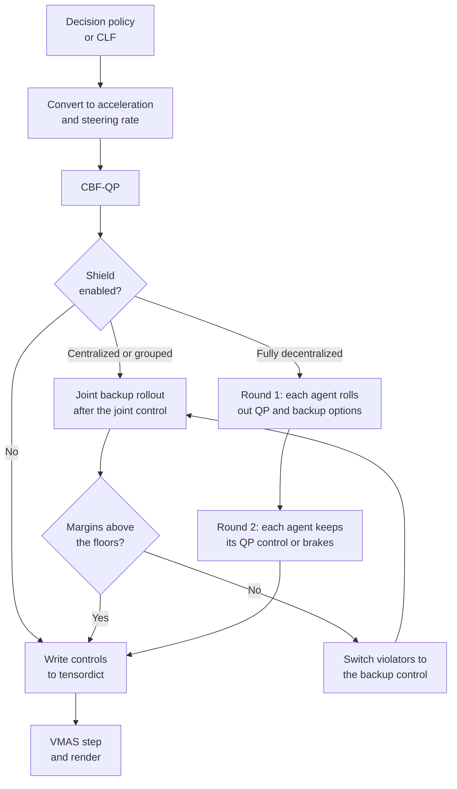

# Backup Shield Pipeline

This document explains how the exact backup shield is integrated into the
CBF-QP pipeline (`main_testing_cbf_filter.py`, `main_testing_clf_cbf_qp.py`,
and the training scripts that filter actions with the CBF-QP). The shield is an
exact backup CBF: it replaced the sampled and lightweight backup CBFs, which
used covering circles, short sampled horizons, or one-step margins and gave no
formal guarantee.

## Control Pipeline Overview

At each rollout step, the controller computes a nominal action and then applies
safety filters before writing the action back to the VMAS environment.

1. The decision-making policy (or the CLF controller) proposes a nominal action.
2. `CBFQP` converts it to low-level vehicle controls: acceleration and steering
   rate. With the standstill escape enabled, a vehicle that its lane keeps
   stopped gets an escape plan as its nominal control (see Standstill Escape).
3. The CBF-QP modifies the nominal control to satisfy the lane and vehicle CBF
   constraints. The vehicle constraints use covering circles, the learned MTV
   margin, or, with `veh_veh_cbf_footprint="rectangle_sat"`, the exact
   rectangle-pair barrier (`sigmarl/pair_sat_barrier.py`), whose rows are
   certified with the lane rows (`_solve_qp_with_sat_repairs`) and keep a
   0.05 W buffer (`pair_safety_buffer`; lane rows and the shield keep 0.01 W). Cross pairs of
   the decentralized and grouped modes split each pair constraint exactly
   between the two agents (the corner budgets of the BH-CBF paper). If the QP is not
   solved, the agent gets the fallback control
   (`cbf_qp_failure_fallback`: its nominal control, or the backup control).
   An escaping vehicle that the QP keeps stopped steers at standstill.
4. The exact backup shield keeps the control only if the state after it stays
   recoverable; otherwise it switches vehicles to the backup control.
5. The low-level controls are converted back to the environment action format
   and written into the tensordict.



For grouped CBF-QP, the grouped solvers first write their local actions, and
the shield then checks the complete joint action once, so cross-group
interactions are covered.

## Backup Maneuver

The backup maneuver is route-tracking emergency braking
(`_shield_backup_controls`, vectorized over vehicles):

- the acceleration is `clip(-v / dt, a_min, a_max)`, maximum braking without
  crossing zero speed, which also stops a reversing vehicle;
- the steering rate tracks a pure-pursuit target one lookahead
  (`max(L, 2 L + 0.2 v)`) ahead of the vehicle's projection on its route, with
  gain 4; steering is therefore route-aware, which matters because the lane
  boundaries are tight polylines;
- the controls are saturated as the simulator applies them
  (`_shield_saturate`).

## Exact Backup Shield

`is_exact_backup_shield=True` (default in `main_testing_cbf_filter.py` and
`main_testing_clf_cbf_qp.py`, off in `Parameters`) adds a last filter after the
CBF-QP in all QP modes (see the decentralized variant below). It needs
`lane_cbf_footprint="rectangle_sat"`; the test scripts turn it off for other
footprints.

A state is recoverable if the joint backup rollout from it, with every vehicle
applying the backup maneuver until all have stopped, keeps every vehicle
rectangle clear of its route boundaries (the buffered rectangle_sat barrier) and
of every other rectangle (separating-axis gap at least the safety buffer). The
rollout uses the same explicit-Euler bicycle map as `WorldCustom`, including its
saturation of the next speed and steering (`_shield_saturate`), and exact
rectangle geometry, with no circle or Taylor approximation. The backup braking
`a = clip(-v / dt, a_min, a_max)` also stops a reversing vehicle.

The shield keeps the joint control if the state after it is recoverable. If not,
vehicles that violate a margin in the rollout switch to the backup control,
repeated until the rollout is clear. With `Parameters.is_shield_priority`
(default `True`), a violated pair is resolved by priority
(`_shield_priority_key`: the simulation step at which the vehicle became
active, i.e., arrival order, then the index): the vehicle with lower priority
switches first, and the other one only if the pair is still violated
(`_shield_priority_switches`); a vehicle with a violated lane margin switches
as before. A final release pass (`_shield_release_pass`) then gives switched
vehicles their input controls back, in priority order, if their new rollout
keeps the joint rollout clear. Otherwise a vehicle that yielded to one that
switched later as well stays stopped with it, which also gridlocked the ring. Without priority, both vehicles of a violated pair switch. Two
stopped vehicles whose QP controls conflict then both keep standing (the
backup control of a stopped vehicle), at every step, which gridlocked the
roundabout in the rounD human comparison. Priority and release change
only which vehicles switch, not the acceptance test, the joint backup
fallback, or the floors, so the guarantee is the same. From a recoverable state, the joint backup
control is always accepted, because the rollout after it is the tail of the
current one. Safety therefore holds by induction as long as the state stays
recoverable.

Unrecoverable states (e.g., a vehicle spawned or respawned inside the lane
buffer) get margin floors. Each lane and pair constraint has a floor `<= 0`
(initially 0). If even the joint backup control violates a floor, the floors of
the violated constraints are lowered to their margins under the joint backup
rollout, and the repair restarts from the input controls (logged as
`EXACT-SHIELD-INF`, `shield_stats["relaxed"]`). A violated margin may therefore
not get worse than braking would make it, while all other constraints keep the
floor 0 and the full guarantee, and vehicles that are not involved are not
braked. After each step, the floors rise to the margins of the accepted rollout
(capped at 0), so the induction carries over to the relaxed constraints. The
floors of a vehicle are reset to 0 when its state departs from the shield's
prediction (respawn, reset, release from hold). From a recoverable state, all
floors are 0 and the shield is unchanged.

Cost: the backup law of a vehicle depends only on its own state, so each
vehicle is rolled out on its own (vectorized over vehicles), lane margins are
evaluated for all rollout poses at once (`LaneSatBarrier.values`), and pair gaps
for all steps and pairs at once. In a repair round only the switched vehicles
are rolled out again. For 12 full-scale vehicles this takes about 5 ms per step.

### Fully Decentralized Shield

With `--max_group_size 1`, no agent knows the joint control, so each agent
decides only its own control in two rounds (`_fd_shield_propose`,
`apply_fully_decentralized_exact_shield` -> `_fd_shield_decide`):

1. After its QP, the agent rolls out two
   options, its QP control and its backup control, each followed by the backup
   policy, evaluates its lane margins along both, and broadcasts both pose
   sequences (stored in the step cache's `shield_proposals`).
2. After all agents have broadcast, the agent keeps its QP control only if its
   lane constraint holds along the QP rollout and, for every neighbor `j`, the
   pair gap holds against the backup rollout of `j` and, if `j` has priority
   (smaller `_shield_priority_key`, broadcast with the proposal; `j < i` with
   `is_shield_priority=False`), also against the QP rollout of `j`. Otherwise
   it applies its backup control.

Every combination of options that can result is checked by an agent that
takes it, except both backup options, which is the joint backup rollout that
the previous step certified. So the guarantee of the centralized shield
carries over. Neighbors are agents whose rollout center boxes are within
`sqrt(2) * (L / 2 + half diagonal + safety buffer)`; farther pairs keep a gap
above the buffer for every option. The margin floors work as above. Each agent
computes the floors of its constraints from the joint backup rollout from the
current state and the previous floors, so both agents of a pair compute the
same floor without extra communication (the pair gap
`_shield_separation` is exactly symmetric). An agent on hold is not checked,
and its floors reset when it moves again. Log-replay agents are not covered.

The parallel cost per agent is two single-vehicle rollouts plus the pair tests
with its neighbors and one broadcast.

## Standstill Escape

The `rectangle_sat` lane rows constrain the pose two steps ahead. A steering
rate moves that pose only in proportion to the next speed, so at standstill
steering has no effect on the rows. A vehicle that stops next to a boundary
with its wheels turned toward it can then neither drive on nor steer away, and
the QP keeps it stopped for good (e.g., a CLF nominal that cuts a corner). The
shield is not involved: it accepts the stopped vehicle's control.

With `Parameters.is_standstill_escape` (`--is_standstill_escape`, on by default
in `main_testing_cbf_filter.py` and `main_testing_clf_cbf_qp.py`;
`rectangle_sat` only), each agent works through the following steps:

1. **Stall detection.** An agent is stalled if it is slower than
   `escape_speed_tol` while its nominal control accelerates. After
   `escape_stall_steps` stalled steps (0.3 s) it searches an escape plan
   (`_escape_search`) and then waits again. A search without a plan is not
   repeated while the pose and the nominal angle stay the same, since its
   result depends only on them (e.g., a vehicle waiting behind another one).
2. **Plans.** A plan sets a fixed steering angle at standstill and then
   creeps half a vehicle length forward or backward with that angle. A plan
   is admissible if the exact lane barrier satisfies
   `B' >= (1 - lambda) B` at every step, and a violated barrier (`B < 0`, e.g.,
   after a respawn) does not get worse (`_escape_plan_margins`, 25 angles).
3. **Choice.**
   - If creeping forward at the nominal angle is admissible, the lane does not
     block the agent and nothing changes.
   - Otherwise, the admissible forward angle closest to the nominal one is
     chosen.
   - Without one, and only if the profile allows negative speeds
     (`min_speed < 0`), a backward plan is chosen. It is preferably one after
     which a forward plan exists, with that forward angle closest to the
     nominal one.
4. **Execution.** The plan replaces the nominal control
   (`_standstill_escape_nominal`): first braking to a stop while steering to
   the plan angle, then creeping in the plan direction with that angle. While
   the wheels still turn and the QP keeps the agent stopped,
   `_standstill_escape_control` sets the next speed to exactly zero and steers
   toward the plan angle. The pose two steps ahead then equals the pose one
   step ahead for every steering rate, so no barrier changes.
5. **End.** The plan ends when the agent has covered the distance, after
   three times its expected duration, or on a respawn.

The escape only changes the input of the CBF-QP and the shield, which still
filter every control, so all safety guarantees are unchanged. Each agent uses
only its own state and lane; in the fully decentralized mode, the escape is
part of the agent's round-1 work and needs no communication. Counts are kept in
`escape_stats` and printed by the test scripts (`escape_statistics`).

## Shield Rollout Visualization

The accepted shield rollout of each vehicle can be rendered with:

```bash
--is_visu_shield_rollout
```

It is enabled by default in the test scripts (`Parameters.is_visu_shield_rollout`
is off) and only draws trajectories when the shield runs. The centralized
shield stores the rollout after the accepted joint control; in the fully
decentralized shield, each agent's chosen option. The center positions start at
the predicted next state and are passed to
`ScenarioRoadTraffic.set_shield_rollout_render(...)`. `extra_render(...)` draws
each rollout as a polyline in the color of its vehicle and marks its last point
with a small circle.

## Statistics and Event Logging

Each controller counts shield decisions in `shield_stats`: `calls`,
`repaired_agent_steps` (vehicles switched to the backup control), and
`repaired_steps` (centralized), `relaxed` (floors lowered), `uncertified`
(centralized: the accepted rollout has a negative margin), and `floor_resets`.
A step in which the floors were lowered (or, centrally, the joint backup
rollout was not clear) appends `EXACT-SHIELD-INF` to the CBF history.

## Computation Time

For fully decentralized runs, report the sequential time (the wall-clock loop
over all agents) and the parallelized estimate separately. The estimate is the
shared per-step preparation, counted in full, plus the slowest agent's QP with
shield round 1, plus the slowest agent's shield round 2
(`apply_fully_decentralized_exact_shield` returns each agent's round-2 time).
Both rounds are per-agent work; round 2 needs the round-1 broadcasts of all
neighbors.

## Debugging

Inspect:

- `agents/info/is_collision_with_agents`;
- `agents/info/is_collision_with_lanelets`;
- `agents/info/is_deadlocked`;
- actual applied controls such as `agents/info/act_vel`,
  `agents/info/act_steer`, `agents/info/applied_action_vel`, and
  `agents/info/applied_action_steer`;
- `time_cbf`.

Do not rely only on `agents/action` for applied low-level controls, because it
may be stale or represent a high-level action format depending on the scenario
configuration.
