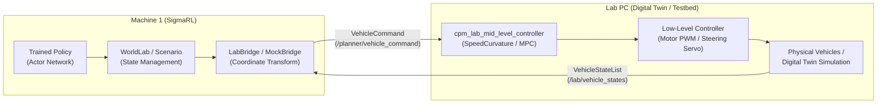
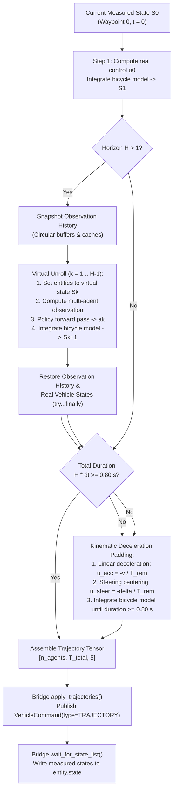

# CPM Lab Bridge and Control Modes

This document details the interface and architecture bridging the SigmaRL
multi-agent motion planning framework with the Cyber-Physical Mobility (CPM)
Lab digital twin and physical vehicle fleet. It describes the communication
mechanisms, frame transformations, supported control modes, and the virtual
trajectory generation pipeline.

The repository for the SigmaR framework is usually called marl_for_cavs (for example, /Users/xu/Documents/my_repo/marl_for_cavs).
The repository for the CPM Lab digital twin is usually called ros2-workspace-lab (for example, /Users/xu/Documents/git_cpm/Lab/ros2-workspace-lab).
---

## 1. System Architecture and Distributed Workflow

The deployment pipeline couples two distinct computational entities:

1. **High-Level MARL Policy Host (Machine 1)**: Runs the SigmaRL evaluation
   environment (`main_eval_lab.py`). It hosts the trained actor-critic neural
   networks, constructs observations, steps the VMAS scenario wrapper, and
   determines vehicle actions.
2. **CPM Lab Environment (Lab PC / Hardware)**: Runs the ROS 2 digital twin
   simulation (or physical 1:18 scale model vehicles) alongside the CPM Lab
   mid-level controllers (`cpm_lab_mid_level_controller`).

Communication is established over a network bridge using ROS 2 topics and
services (often tunneled via Zenoh or CycloneDDS):



### Protocol and Synchronization

The bridge operates via a synchronous push-pull protocol:

1. **Push**: At each control interval $\Delta t$, SigmaRL constructs and publishes
   a `cpm_lab_lab_msgs/msg/VehicleCommand` for every active vehicle. Each command
   includes a validity timestamp `valid_after_stamp` set to $t_{\text{now}} + \Delta t_{\text{valid}}$
   to ensure synchronized execution and prevent actuator jitter.
2. **Pull**: SigmaRL blocks on `wait_for_state_list()`, waiting for the next
   post-command `cpm_lab_lab_msgs/msg/VehicleStateList` snapshot published on
   `/lab/vehicle_states`.
3. **State Injection**: The measured positions, headings, velocities, and steering
   angles are written directly back into each agent's `entity.state`. The next
   observation cycle is computed using these measured values.

---

## 2. Coordinate Systems and Frame Transformations

SigmaRL and the CPM Lab use distinct right-handed coordinate frames. The CPM
Lab origin is located at one corner of the physical testbed, whereas SigmaRL
aligns the origin with the map boundaries. The mapping is an isometric reflection
and translation:

$$\begin{aligned}
x_{\text{sigmarl}} &= x_{\text{dim}} - x_{\text{lab}} \\
y_{\text{sigmarl}} &= y_{\text{dim}} - y_{\text{lab}} \\
\psi_{\text{sigmarl}} &= \operatorname{wrap}(\psi_{\text{lab}} + \pi)
\end{aligned}$$

Conversely, commands transformed from the SigmaRL frame into the CPM Lab frame
satisfy:

$$\begin{aligned}
x_{\text{lab}} &= x_{\text{dim}} - x_{\text{sigmarl}} \\
y_{\text{lab}} &= y_{\text{dim}} - y_{\text{sigmarl}} \\
\psi_{\text{lab}} &= \operatorname{wrap}(\psi_{\text{sigmarl}} + \pi)
\end{aligned}$$

Planar vehicle yaw $\psi_{\text{lab}}$ is converted to 3D orientation
quaternions $(q_x, q_y, q_z, q_w)$ via:

$$\mathbf{q} = \left(0,\; 0,\; \sin\frac{\psi_{\text{lab}}}{2},\; \cos\frac{\psi_{\text{lab}}}{2}\right)$$

---

## 3. Supported Control Modes

The control mode is selected via the CLI option `--lab-mode` and stored in
`Parameters.lab_mode`.

| Mode | Command Type | Mid-Level Controller | Description |
| :--- | :--- | :--- | :--- |
| `speed_curvature` | `VehicleCommand.SPEED_CURVATURE` (3) | `SpeedCurvatureController.cpp` | Single-step speed and curvature command (default). |
| `trajectory` | `VehicleCommand.TRAJECTORY` (4) | `MpcController.cpp` | Multi-step timestamped reference trajectory. |
| `direct` | `VehicleCommand.DIRECT` (1) | None | Direct motor PWM and steering servo commands (not supported, raises `NotImplementedError`). |
| `path_tracking` | `VehicleCommand.PATH_TRACKING` (2) | `PathTrackingController.cpp` | Pure geometric path tracking (not supported, raises `NotImplementedError`). |

### Mode: `speed_curvature`

In `speed_curvature` mode, the environment sends one command per vehicle per
control tick:
- Target speed: $v_{\text{cmd}} \in [v_{\min}, v_{\max}]$
- Target path curvature: $\kappa_{\text{cmd}} = \delta_{\text{cmd}} / l_{\text{wb}}$

The CPM Lab mid-level controller translates target curvature to front wheel
steering angle via $\delta = l_{\text{wb}} \cdot \kappa$, tracking speed with a
feedforward motor curve and a proportional-integral (PI) velocity controller.

### Mode: `trajectory`

In `trajectory` mode, the environment provides an array of timestamped spatial
waypoints (`cpm_lab_lab_msgs/msg/PathPoint[] path`). Each point contains:
- `time`: Absolute execution timestamp $t_k = t_{\text{now}} + k \cdot \Delta t$
- `pose`: 3D position $(x, y, 0)$ and quaternion orientation $\mathbf{q}$
- `speed`: Target linear velocity $v_k$
- `distance`: Cumulative path arc length from the first point

Tracking is performed by the CPM Lab `MpcController.cpp`. The controller
compensates for computation and transmission delay ($N_{\text{delay}} = 3$ steps)
and solves a constrained finite-horizon quadratic optimization problem over an
MPC prediction horizon ($N_{\text{mpc}} = 6$ steps, $\Delta t_{\text{mpc}} = 0.05\,\text{s}$).

#### MPC Lead-Time Constraint

The lab MPC controller verifies that the supplied reference trajectory covers the
entire prediction interval:

$$\begin{aligned}
t_{\text{start}} &= t_{\text{now}} + N_{\text{delay}} \cdot \Delta t_{\text{loop}} + \Delta t_{\text{mpc}} = t_{\text{now}} + 0.11\,\text{s} \\
t_{\text{end}} &= t_{\text{start}} + (N_{\text{mpc}} - 1) \cdot \Delta t_{\text{mpc}} = t_{\text{now}} + 0.36\,\text{s}
\end{aligned}$$

If the trajectory terminates before $t_{\text{end}}$ ($t_{\max} < t_{\text{now}} + 0.36\,\text{s}$),
`interpolateReferenceTrajectory()` returns `false`, causing the controller to
trigger an immediate emergency stop (`stop_vehicle_ = true`). Consequently, all
trajectories generated by SigmaRL must provide a total lead time of at least
$0.40\,\text{s}$.
trigger an immediate emergency stop (`stop_vehicle_ = true`). Consequently,
SigmaRL configures a default lead time target of at least $0.80\,\text{s}$
(`min_lead_time = 0.80`), providing an $8$-step buffer ($400\,\text{ms}$)
to tolerate real-time scheduling variations without vehicle stalling.

---

## 4. Trajectory Generation: Virtual Rollout and Constant Deceleration Padding

Standard MARL policies generate instantaneous one-step actions $\mathbf{a}_t$.
To support `trajectory` mode, `WorldLab._step_trajectory()` synthesizes multi-step
trajectories by combining:
1. Virtual multi-agent policy unrolling ($H$ steps, where $H = \text{lab\_traj\_horizon}$).
2. Kinematic deceleration padding ($N_{\text{pad}}$ steps) to guarantee the $0.40\,\text{s}$ lead time.
2. Kinematic deceleration padding ($N_{\text{pad}}$ steps) to guarantee the $0.80\,\text{s}$ lead time.



### Virtual Rollout Execution

1. **Step 0**: The nominal action from the policy for the current step is
   converted into low-level controls $(a_0, \dot{\delta}_0)$ via
   `compute_applied_action_control()`. The kinematic bicycle model is stepped
   forward by $\Delta t$ to generate Waypoint 1.
2. **State and Buffer Preservation**: Before evaluating steps $k = 1 \dots H-1$,
   `WorldLab` records a deep snapshot of:
   - Entity states: positions, rotations, speeds, steering angles, and velocities.
   - Observation provider circular buffers: `past_pos`, `past_rot`,
     `past_distance_to_agents`, `past_vertices`, etc.
   - Observation caches and stored observation dictionaries.
3. **Iterative Policy Unrolling**: For each step $k$:
   - The virtual vehicle state $S_k$ is injected into the entities.
   - Observations for all agents are evaluated via `scenario.observation(agent)`.
   - The policy network evaluates the batched observations in inference mode.
   - Applied controls are integrated through the kinematic bicycle model to yield $S_{k+1}$.
4. **State Restoration**: A `try...finally` block guarantees that real vehicle
   states and observation histories are restored to their exact pre-rollout values,
   ensuring that virtual rollout steps never corrupt subsequent environment steps.

### Constant Action Deceleration Padding

If the virtual rollout duration $H \cdot \Delta t < 0.40\,\text{s}$, the
If the virtual rollout duration $H \cdot \Delta t < 0.80\,\text{s}$, the
trajectory is padded using deterministic kinematic extrapolation:

$$N_{\text{pad}} = \left\lceil \frac{0.40 - H \cdot \Delta t}{\Delta t} \right\rceil$$
$$N_{\text{pad}} = \left\lceil \frac{0.80 - H \cdot \Delta t}{\Delta t} \right\rceil$$

For each padding step $p \in \{0, \dots, N_{\text{pad}} - 1\}$ with remaining
time $T_{\text{rem}} = (N_{\text{pad}} - p) \cdot \Delta t$:

$$\begin{aligned}
u_{\text{acc}} &= \operatorname{clamp}\left(-\frac{v}{T_{\text{rem}}},\; a_{\min},\; a_{\max}\right) \\
u_{\text{steer}} &= \operatorname{clamp}\left(-\frac{\delta}{T_{\text{rem}}},\; \dot{\delta}_{\min},\; \dot{\delta}_{\max}\right)
\end{aligned}$$

This smoothly decelerates the vehicle to zero speed and centers steering angle
to zero along the road tangent without requiring expensive neural network
forward passes.

---

## 5. Backends: `LabBridge` vs. `MockBridge`

The architecture provides two interchangeable implementations of `BridgeBase`:

### `LabBridge`
- Used for hardware-in-the-loop experiments and digital twin verification.
- Interacts with ROS 2 via `rclpy`.
- Subscribes to `/lab/vehicle_states` and publishes to `/planner/vehicle_command`.
- Supports automated reset via the `/lab/respawn_vehicles` ROS service, as well
  as manual human-in-the-loop reset (`--manual-reset`) for real hardware.

### `MockBridge`
- An in-process loopback backend requiring no ROS 2 installation or external processes.
- Simulates physical vehicle integration using the same kinematic bicycle model
  as the lab simulator.
- Exercises the complete coordinate transformation, trajectory formatting, and
  synchronization pipeline offline.
- Serves as the regression testing baseline (`sigmarl/tests/test_lab_mock_equivalence.py`).

---

## 6. Diagnostic Tools and Visualizations

### Stale State Detection
When evaluating against real hardware or a digital twin over the network, clock
drift or network delays can lead to duplicated state snapshots. `WorldLab`
includes a freshness monitor (`check_stale_states`):

$$\max_i \left( |p_{i, t} - p_{i, t-1}| + |\psi_{i, t} - \psi_{i, t-1}| + |v_{i, t} - v_{i, t-1}| \right) \le \epsilon_{\text{atol}}$$

If states remain identical across steps, a warning is logged with the cumulative
stale count and percentage.

### Trajectory Visualization Script
To visually verify trajectory generation, use `scripts/visualize_lab_trajectory.py`:

```bash
python scripts/visualize_lab_trajectory.py \
    --model-dir checkpoints/icra27/lab \
    --lab-traj-horizon 3 \
    --n-steps 30 \
    --save-frames 0,5,10,15,20,25 \
    --view-mode both \
    --output-dir outputs/visualize_lab_trajectory
```

The script renders:
- High-definition road network boundaries and centerlines.
- Oriented vehicle footprints (bounding boxes of size $0.22\,\text{m} \times 0.107\,\text{m}$)
  with heading vectors.
- Virtual MARL action waypoints rendered as blue circles (`#0066FF`).
- Appended constant deceleration waypoints rendered as orange diamonds (`#FF5500`).

---

## 7. Command Reference

### Summary of CLI Arguments for `main_eval_lab.py`

| Flag | Values | Default | Description |
| :--- | :--- | :--- | :--- |
| `--backend` | `mock`, `lab` | `lab` | Physics provider (`mock` for local loopback, `lab` for ROS 2). |
| `--lab-mode` | `speed_curvature`, `trajectory` | `speed_curvature` | Low-level tracking mode. |
| `--lab-traj-horizon`| Integer $\ge 1$ | `3` | Number of virtual policy steps for trajectory generation. |
| `--period-ms` | Integer | `50` | Control step duration $\Delta t$ in milliseconds (e.g. 50 ms = 0.05 s). |
| `--vehicle-ids` | Comma-separated ints | `1,2,3,4` | IDs of vehicles controlled in the testbed. |
| `--manual-reset` | Boolean flag | `False` | Enables human-in-the-loop positioning for real hardware resets. |
| `--scenario-type` | String | `cpm_intersection_extended` | Scenario asset and map layout. |
| `--max-steps` | Integer | `2400` | Maximum rollout steps per evaluation episode. |

### Example Invocations

```bash
# 1. Offline mock evaluation in speed_curvature mode:
python main_eval_lab.py --backend mock --lab-mode speed_curvature \
    --model-dir checkpoints/icra27/lab --period-ms 50

# 2. Offline mock evaluation in trajectory mode (5-step horizon):
python main_eval_lab.py --backend mock --lab-mode trajectory --lab-traj-horizon 5 \
    --model-dir checkpoints/icra27/lab --period-ms 50

# 3. Digital twin ROS evaluation in trajectory mode:
python main_eval_lab.py --backend lab --lab-mode trajectory --lab-traj-horizon 3 \
    --model-dir checkpoints/icra27/lab --vehicle-ids 1,2,3,4 --period-ms 50

# 4. Physical lab hardware evaluation (manual reset):
python main_eval_lab.py --backend lab --lab-mode trajectory --lab-traj-horizon 3 \
    --model-dir checkpoints/icra27/lab --vehicle-ids 1,2,3,4 --period-ms 50 --manual-reset
```
